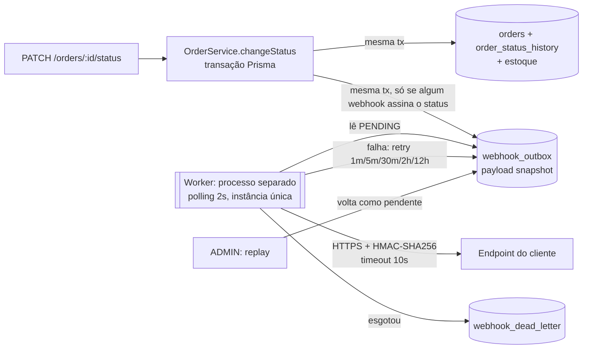

# RFC-001: Sistema de Webhooks de Notificação de Pedidos

## Metadados

| Campo | Valor |
|---|---|
| **Autor** | Larissa (Tech Lead), que se comprometeu a abrir o documento de design ([09:50] Larissa). Redação: Ricardo, com apoio de IA |
| **Status** | Em revisão |
| **Data** | 2026-11-06 |
| **Revisores** | Bruno (Eng. Pleno, Pedidos) · Diego (Eng. Sênior, Plataforma) · Sofia (Eng. de Segurança) · Marcos (PM) |
| **Sessão de revisão** | Larissa + Bruno + Diego, antes de começar a codar ([09:50] Larissa) |
| **Documentos** | [PRD](PRD.md) (por quê / o quê) · [FDD](FDD.md) (como construir) · [ADRs](adrs/) (decisões) · [Tracker](TRACKER.md) (origem de cada item) |

---

## 1. Resumo executivo (TL;DR)

Propomos **webhooks outbound** que notificam os clientes B2B quando o status de um pedido muda, em menos de 10 segundos.

A mudança de status grava o evento numa tabela **outbox no MySQL**, na mesma transação. Um **worker em processo separado** lê essa tabela a cada 2s e entrega o evento por HTTPS, assinado com **HMAC-SHA256 e uma secret por endpoint**. A garantia de entrega é **at-least-once**, com deduplicação pelo `X-Event-Id`. Falhas têm **5 retentativas com backoff de 1m a 12h** e depois vão para uma **DLQ com replay manual por ADMIN**.

Nenhuma infraestrutura nova: o webhook é um módulo a mais em `src/modules/`, reaproveitando erros, logger, validação e autorização que já existem.

## 2. Contexto e problema

- Três clientes B2B (Atlas Comercial, MaxDistribuição, Nova Cargo) pediram formalmente para ser notificados em tempo real da mudança de status dos pedidos ([09:00] Marcos).
- Hoje eles fazem polling em `GET /orders`, o que deixa a integração lenta e cara para eles ([09:00] Marcos).
- A Atlas sinalizou que pode migrar para um concorrente se a entrega não acontecer ([09:00] Marcos), e quer a feature até o fim de novembro ([09:45] Marcos).
- "Tempo real", para os clientes, é qualquer coisa abaixo de 10s ([09:02] Marcos).
- O fluxo é só de saída: a plataforma notifica, o cliente não envia nada ([09:02] Marcos, [09:03] Sofia).

**Restrições do sistema atual:**

- O OMS não tem eventos, filas nem notificação externa.
- A mudança de status (`changeStatus` em `src/modules/orders/order.service.ts`) já é uma transação com várias escritas: pedido, histórico e, em certas transições, estoque. Ela não pode ficar refém da disponibilidade de terceiros ([09:04] Bruno).

## 3. Proposta técnica

**Componentes**

1. **Captura transacional (outbox).** `changeStatus` chama `publishWebhookEvent(tx, …)`. Essa função grava um evento por webhook assinante, já com o payload final (snapshot). Se a gravação falha, a mudança de status também falha. Ver [ADR-001](adrs/ADR-001-outbox-no-mysql.md) e [ADR-007](adrs/ADR-007-snapshot-e-filtro-na-insercao-do-outbox.md).
2. **Entrega assíncrona.** Um processo Node separado faz polling a cada 2s, com instância única. A ordem é preservada por webhook, e um cliente lento não segura os demais. Ver [ADR-002](adrs/ADR-002-worker-separado-em-polling.md).
3. **Resiliência.** Timeout de 10s e 5 retentativas com backoff exponencial. Depois disso o evento vai para a DLQ, de onde só um ADMIN pode fazer replay. Ver [ADR-003](adrs/ADR-003-retry-com-backoff-e-dlq.md).
4. **Segurança.**
   - HMAC-SHA256 do corpo, com secret gerada por endpoint e rotação com 24h de carência ([ADR-004](adrs/ADR-004-hmac-sha256-com-secret-por-endpoint.md)).
   - HTTPS obrigatório e payload limitado a 64KB. São requisitos não funcionais, não decisões de arquitetura ([09:23] Sofia, [09:24] Larissa).
5. **Contrato de entrega.**
   - Garantia at-least-once, com `X-Event-Id` estável ([ADR-005](adrs/ADR-005-entrega-at-least-once-com-x-event-id.md)).
   - Headers `X-Event-Id`, `X-Signature`, `X-Timestamp` e `X-Webhook-Id` ([09:44] Diego, [09:44] Sofia).
   - Payload enxuto, sem itens do pedido ([09:43] Diego).
6. **API de configuração.** CRUD de webhooks por cliente, histórico de entregas e replay de DLQ. O `customer_id` é informado explicitamente no body ou no path, **não** vem do JWT, porque o JWT é do usuário operador ([09:32] Bruno, [09:32] Larissa). Contratos no [FDD](FDD.md#5-contratos-públicos).
7. **Padrões.** Módulo `src/modules/webhooks/`, erros `AppError` com prefixo `WEBHOOK_`, Pino e o `error.middleware` atual. Ver [ADR-006](adrs/ADR-006-reuso-dos-padroes-existentes.md).

**Estimativa:** 3 sprints, já incluindo a revisão de segurança da Sofia no fim ([09:46] Larissa, [09:47] Larissa).

## 4. Alternativas consideradas

| # | Alternativa | Trade-off que levou ao descarte | Origem |
|---|---|---|---|
| ALT-1 | **Chamada HTTP síncrona dentro de `changeStatus`** | Um cliente lento trava mudanças de status de outros pedidos. Se o cliente estiver fora do ar, não há resposta correta: dar rollback no status não faz sentido. | [09:04] Bruno, [09:06] Diego |
| ALT-2 | **Redis Streams / broker dedicado** | Entrega reatividade e escala, mas exige infraestrutura nova. Para um time pequeno é overengineering, e o outbox no MySQL resolve. | [09:07] Larissa, [09:07] Diego |
| ALT-3 | **Trigger do MySQL para acordar o worker** | O MySQL não tem `LISTEN/NOTIFY`. Uma trigger só executa SQL, então avisar o worker exigiria improvisos. O polling de 2s já atende os 10s. | [09:09] Bruno, [09:09] Diego |
| ALT-4 | **Retry indefinido** ou **só 3 tentativas** | Retry indefinido deixa eventos pendurados para sempre. Três tentativas (cerca de 30 min) não cobrem indisponibilidades reais de horas. | [09:15] Diego, [09:16] Bruno, [09:16] Diego |
| ALT-5 | **Secret global da plataforma** | É mais simples de gerenciar, mas um vazamento expõe todos os clientes. | [09:21] Sofia |
| ALT-6 | **Exactly-once** | Exigiria coordenação dos dois lados e muito mais complexidade. At-least-once com `event_id` resolve a grande maioria dos casos. | [09:25] Diego |
| ALT-7 | **Montar o payload no envio** (guardar só `order_id`) | Durante o retry, o evento refletiria o estado atual do pedido, não o da transição. | [09:52] Larissa |

## 5. Questões em aberto

| # | Questão | Situação | Origem | Como seguimos enquanto não há decisão |
|---|---|---|---|---|
| Q1 | **Rate limiting de saída por cliente** (ex.: 50 pedidos mudando de status em 1 min viram 50 chamadas) | Adiado: "observar e decidir depois" | [09:38] Diego, [09:39] Larissa | Sem limite. Acompanhar o volume por webhook nos logs do worker ([FDD §8](FDD.md#8-observabilidade)). |
| Q2 | **Aviso ao cliente quando o webhook falha** (ex.: e-mail depois de 3 falhas seguidas) | Adiado para a próxima fase, depois de medir o impacto | [09:37] Marcos, [09:37] Larissa | Visibilidade só via `GET /webhooks/:id/deliveries`. |
| Q3 | **Escalar para vários workers** sem perder a ordem por pedido | Futuro: particionar por `order_id` ou usar lock pessimista | [09:13] Diego, [09:13] Larissa | Instância única, documentada como limitação ([ADR-002](adrs/ADR-002-worker-separado-em-polling.md)). |
| Q4 | **Arquivamento de linhas entregues do outbox** (~30 dias) | Fora do escopo desta feature | [09:08] Diego | A tabela cresce. Índices em status e `created_at`. |
| Q5 | **Endurecer as permissões do CRUD de webhooks.** Hoje qualquer usuário autenticado pode configurar webhooks de **qualquer** cliente, porque o schema não liga usuário a cliente (`UserRole` só tem `ADMIN`/`OPERATOR`) | "Por enquanto sim; mais pra frente a gente pode endurecer" | [09:37] Sofia; `prisma/schema.prisma` | CRUD liberado para qualquer papel autenticado. |
| Q6 | **Ordem por pedido durante retry.** Com backoff, um evento posterior do mesmo pedido pode ser entregue antes de um que está esperando retentativa, mesmo com um worker só. A reunião só considerou a perda de ordem por paralelismo | Não discutido; precisa de decisão | Derivado de [09:12] Diego e [09:17] Larissa | Sem bloqueio por pedido. O cliente ordena por `timestamp` e `to_status`. Alternativa: segurar os eventos seguintes de `(webhook, order_id)` enquanto houver um em retry. |
| Q7 | **Assinatura: pontos para a revisão de segurança.** (a) Como sinalizar duas secrets válidas durante as 24h de carência. (b) O HMAC cobre só o corpo, então o `X-Timestamp` não é assinado, o que enfraquece a detecção de replay. (c) Como proteger a secret em repouso, já que ela não pode ser guardada como hash | Para a revisão da Sofia | [09:21] Sofia, [09:22] Sofia, [09:44] Diego, [09:46] Sofia | O FDD traz uma proposta concreta ([FDD §5.1](FDD.md#51-requisição-enviada-ao-cliente-outbound)), sujeita a essa revisão. |
| Q8 | **Evento na criação do pedido.** A reunião só tratou de mudanças de status (`changeStatus`). A criação de um pedido também grava histórico (`null → PENDING`), mas não ficou definido se ela notifica | Não discutido | `src/modules/orders/order.service.ts` | Fora desta fase: só mudanças de status geram evento. |

## 6. Impacto e riscos

### Impacto no sistema existente

- **`changeStatus`:** ganha uma leitura (webhooks ativos do cliente) e N inserts dentro da transação. Uma falha nesse ponto faz rollback da mudança de status. Isso é intencional ([09:40] Bruno).
- **Banco de dados:** quatro tabelas novas (configuração, outbox, histórico de entregas, DLQ) e uma migration Prisma.
- **Operação:** um segundo processo para deployar e monitorar (`npm run worker`) ([09:11] Larissa), com uma conexão Prisma própria ([09:30] Bruno).
- **Clientes:** precisam deduplicar por `X-Event-Id` e verificar o HMAC. O produto documenta isso no portal ([09:26] Marcos, [09:40] Marcos).

### Riscos de arquitetura

Os riscos de produto, com probabilidade e impacto, estão no [PRD §10](PRD.md#10-riscos-e-mitigação). As mitigações técnicas estão no [FDD §13](FDD.md#13-riscos-e-mitigação). Ficam aqui só os riscos que nascem das escolhas desta proposta:

| Risco | Origem na proposta | Tratamento |
|---|---|---|
| Ponto único de falha na entrega | Instância única do worker ([ADR-002](adrs/ADR-002-worker-separado-em-polling.md)) | Eventos persistidos, sem perda. Alerta de atraso. A escala horizontal é Q3 |
| Crescimento contínuo do outbox | Outbox sem arquivamento nesta fase ([ADR-001](adrs/ADR-001-outbox-no-mysql.md)) | Índices. O arquivamento é Q4 |
| Sequência fora de ordem durante retry | Retry por evento ([ADR-003](adrs/ADR-003-retry-com-backoff-e-dlq.md)) | Contrato orienta ordenar por `timestamp`. A decisão é Q6 |

## 7. Decisões relacionadas

| ADR | Decisão |
|---|---|
| [ADR-001](adrs/ADR-001-outbox-no-mysql.md) | Padrão Outbox no MySQL, na mesma transação da mudança de status |
| [ADR-002](adrs/ADR-002-worker-separado-em-polling.md) | Worker em processo separado, polling de 2s, instância única |
| [ADR-003](adrs/ADR-003-retry-com-backoff-e-dlq.md) | Retry 1m/5m/30m/2h/12h, DLQ em tabela própria, replay por ADMIN |
| [ADR-004](adrs/ADR-004-hmac-sha256-com-secret-por-endpoint.md) | HMAC-SHA256, secret por endpoint, rotação com 24h de carência |
| [ADR-005](adrs/ADR-005-entrega-at-least-once-com-x-event-id.md) | At-least-once com deduplicação via `X-Event-Id` |
| [ADR-006](adrs/ADR-006-reuso-dos-padroes-existentes.md) | Reuso dos padrões do projeto: módulos, `AppError`, Pino, `WEBHOOK_*` |
| [ADR-007](adrs/ADR-007-snapshot-e-filtro-na-insercao-do-outbox.md) | Payload snapshot e filtro de eventos na inserção do outbox |
